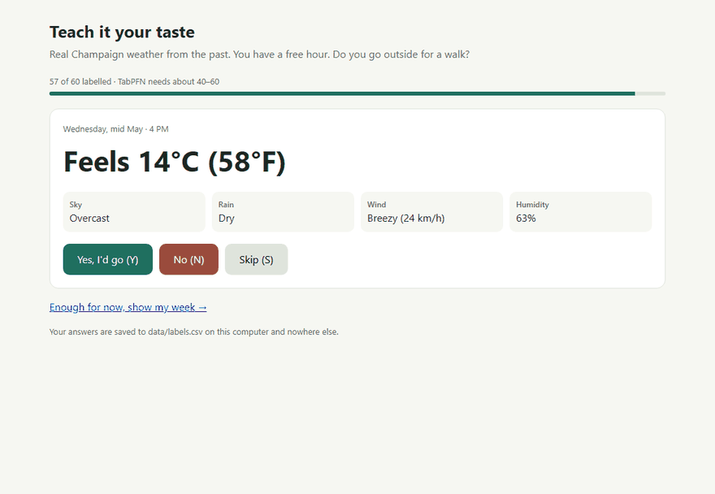

# Touch Grass Window

Teach an open model your own "would I actually go outside?" taste in 60 clicks. It tells you this week's
outdoor windows, and how many days like today you have left before the year ends. Everything runs on your own computer.

Built in one day for the [DEV Hacktoberfest Open-Source AI Challenge, Week 1: Touch Grass](https://dev.to/challenges/hacktoberfest-week1-2026-10-05).
**Built with PriorLabs-TabPFN.**



## How it works

```
10 years of hourly Champaign weather (Open-Meteo archive, 87,672 hours)
        │
        ├──► 60 past hours shown as cards ──► you answer Y / N  ──► data/labels.csv (stays local)
        │                                                              │
        │                                         TabPFN v2 (open weights, in-context, CPU)
        │                                                              │
        ├──► applied to 2016–2025 history ──► "days like this left this year"
        │                                                              │
 7-day forecast (Open-Meteo) ──────────────────► hourly p(go) ──► windows (daylight, free, no thunderstorm)
                                                                       │
                                     Gemma 4 E4B via Ollama writes one nudge from those facts only
```

- **Your taste, not a weather app's.** A generic "nice weather" rule says 15–27 °C, dry, light wind. Real people
  disagree: I'll walk in 12 °C drizzle but not in 5 °C sunshine. TabPFN is a tabular foundation model, so it learns
  from about 60 labelled rows with no training loop.
- **Windows, not forecasts.** Hourly probabilities are filtered to daylight, your free hours
  (`data/free_hours.json`) and storm-free hours, then grouped into runs and capped at sunset.
- **Rain is your call.** The only hard veto is a thunderstorm forecast (lightning). Everything else is your taste.
- **Rarity.** The same model is run over ten Octobers-to-Decembers of real history (daylight hours 9:00–18:00) to count,
  per year, the days with 2+ hours you'd have gone out in. "About N more days like this" is a typical-year average
  with its range.
- **A nudge, not a dashboard.** Code picks the window, the spot and what changes later in the week; Gemma 4 runs locally
  and only phrases those facts. Every number it writes in digits is checked against the facts; on a miss it retries,
  and after three misses it falls back to a plain template.

## Run it

Requirements: Python 3.11+ (tested on 3.13), [Ollama](https://ollama.com).

```bash
ollama pull gemma4:e4b
python -m venv .venv
.venv/Scripts/pip install torch --index-url https://download.pytorch.org/whl/cpu   # Linux/macOS: .venv/bin/pip
.venv/Scripts/pip install -r requirements.txt
.venv/Scripts/python app.py          # open http://127.0.0.1:5050
.venv/Scripts/python app.py --offline   # cached forecast, no network at all
```

First run downloads the weather history (~4 MB) and the TabPFN v2 weights from Hugging Face. After that, `--offline`
works with no connection: TabPFN, Gemma and your labels are all local. TabPFN runs on CPU (on my desktop it scores
2,000 hours in under 2 seconds).

Optional config: copy `data/free_hours.example.json` to `data/free_hours.json` (your class schedule),
`data/spots.example.json` to `data/spots.json` (your places). Another city: change `LAT`, `LON`, `TZ` in
`tgw/weather.py` and delete `data/history.csv` and `data/cards.csv`.

## Does it actually learn a personal taste?

Repeated 5-fold cross-validation (×3) on my own labels, compared with the generic rule and logistic regression.
The app recomputes this table on your labels (`data/eval.json`).

| Model | Accuracy | ROC AUC |
|---|---|---|
| Generic "nice weather" rule (feels 15–27 °C, dry, wind < 25 km/h) | 0.55 | 0.61 |
| Logistic regression | 0.79 | 0.84 |
| **TabPFN v2** (open weights, in-context, no training loop) | **0.89** | **0.94** |

60 labels (35 yes; always saying yes would score 0.58 accuracy). The generic rule disagreed with me on 27 of 60 hours,
and every time it was the rule saying no while I said yes: cold stops me, rain doesn't. With my taste, a typical year
has about **29** more days like today after Oct 11 (range 10–42 over 2016–2025); the generic rule would count about
**9** (range 2–18).

## Tests

`pip install pytest`, then `python -m pytest -q` runs the guard tests (no TabPFN or Ollama needed): double-submitted
labels count once, windows end at sunset, thunderstorms veto, a nudge with an invented number is rejected, and the
example config files load.

## What runs where

| Piece | Where | Network |
|---|---|---|
| Your labels, schedule, places | `data/` on your disk | never sent anywhere |
| TabPFN v2 | local CPU | weights downloaded once |
| Gemma 4 E4B | local Ollama | model downloaded once |
| Weather | Open-Meteo public API | only fixed city coordinates are sent; cached for offline use |

## Credits

- Built with PriorLabs-TabPFN: [TabPFN](https://github.com/PriorLabs/TabPFN) v2 weights by Prior Labs
  ([Prior Labs License](https://huggingface.co/Prior-Labs/TabPFN-v2-clf/blob/main/LICENSE.txt), Apache 2.0 with
  attribution); the `tabpfn` package is Apache 2.0
- [Gemma 4](https://ai.google.dev/gemma) by Google (Apache 2.0), served by [Ollama](https://ollama.com)
- Weather data by [Open-Meteo.com](https://open-meteo.com) ([CC BY 4.0](https://creativecommons.org/licenses/by/4.0/))
- Flask, scikit-learn, pandas
- Code written with help from Claude Code (an AI coding agent)

MIT License.
